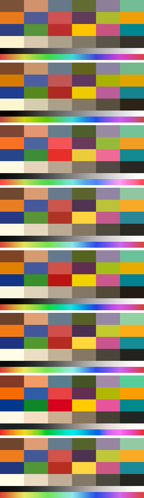

# derby-film

The film looks and film effects from [Derby](https://derbysocial.app), a photo
app for friends. Each look is a film stock modelled from its manufacturer's
published datasheet, rather than a hand-tuned filter. You can use them in your
own editor as `.cube` LUTs, or in a Flutter app as a fragment shader.



*From the top: the untouched chart (ColorChecker patches, a grey ramp, a hue
sweep), then FLASH, FEVER, HUSH, RUSH, CLUB, AFTER and ACID.*

## The looks

| Look | Modelled from | How it's rendered |
|---|---|---|
| FLASH | Kodak Ektachrome E100VS | A vivid slide, projected |
| FEVER | Kodak Gold 200 | Exposed a stop over, lab-scanned, a quarter of a print mixed in |
| HUSH | Fujicolor Pro 160S | Exposed a stop over, lab-scanned, a quarter of a print mixed in |
| RUSH | Fujichrome Velvia 100 | A saturated slide, projected |
| CLUB | Fujicolor Pro 400H | Lab-scanned, a quarter of a print mixed in |
| AFTER | Kodak Portra 800 | Printed on Kodak Endura Premier paper |
| ACID | Fujicolor Superia X-TRA 400 | Exposed a stop under, lab-scanned, a quarter of a print mixed in |

These are models built from published curves, not the films themselves. They
haven't been checked against real scans. The film names credit the datasheets
the curves come from; Derby has no affiliation with Kodak, Kodak Alaris,
Fujifilm or Agfa.

## How a look is made

`bake.py` follows the light through the film:

1. **Undo the phone.** The input is a finished JPEG or HEIC, not a RAW file.
   The tool undoes a standard camera tone curve (the DNG SDK default) to
   estimate the light in the scene.
2. **Expose the film.** Each colour becomes a plausible light spectrum, using
   Jakob and Hanika's 2019 model. The spectrum exposes the film's three layers
   through their published spectral sensitivities.
3. **Develop it.** The characteristic curves turn each layer's exposure into
   dye density. Exposure decides where a colour sits on the film's toe and
   shoulder, which is where film's soft highlights and dense shadows come from.
4. **Make a picture.** One of three ways:
   - **Scanned negative:** each channel is inverted and balanced on grey, as a
     lab scanner does. `contrast` sets the scanner harder than the film.
   - **Projected slide:** the slide's dyes are seen under projector light.
   - **Print:** an enlarger lamp shines through the film's dyes onto the
     paper's own layers, and the print is seen under daylight. `print` mixes
     a share of the print into a scan, as light.

No colour is adjusted by hand for any hue. Every colour shift, including how
reds deepen and how greens drift, comes from the datasheets. Every look keeps
mid grey neutral.

The film model and the datasheet curves come from
[RAWmakase](https://github.com/pch/rawmakase/pull/404) (MIT). RAWmakase reads
the curves straight from the vector paths in each datasheet PDF. Thank you to
its contributors.

## Use the LUTs

`looks/*.cube` are 33-point 3D LUTs, sRGB in and sRGB out. Lightroom (as a
profile), Photoshop, DaVinci Resolve, Premiere, Final Cut and most photo and
video editors can open them. Apply one to a finished, display-referred image
such as a phone photo or an sRGB export, not to log or RAW footage.

## Use the effects (Flutter)

`shader/derby_film.frag` is the shader Derby renders photos with. It applies
the look and five film effects:

| Effect | What it models |
|---|---|
| Diffusion | A mist filter in front of the lens: bright things bloom softly in their own colour |
| Vignette | The light a lens loses toward the corners (cos⁴), added before the look so the film's own shadows darken |
| Glow | Halation: light that bounced off the back of the film and re-exposed the red layer around bright light sources |
| Leak | Light that got into the camera and fogged the film from one edge, in film's reds, ambers and magentas |
| Grain | Film grain whose weight, clump size and colour come from the look's film (`looks/grain.json`) |

Diffusion, vignette, glow and leak are added as light before the look, so the
film renders them the way it renders the rest of the picture. Grain goes on
the finished image. Effect levels run from 0 (off) to 10, and 5 is each
effect's intended strength.

Add the shader to `pubspec.yaml` under `flutter: shaders:`, then:

```dart
final program = await ui.FragmentProgram.fromAsset('shaders/derby_film.frag');
final shader = program.fragmentShader()
  ..setFloat(0, width)            // u_size
  ..setFloat(1, height)
  ..setFloat(2, 1.0)              // u_strength: 0 = no look, 1 = full look
  ..setFloat(3, 33)               // u_cube_size
  ..setFloat(4, grainLevel)       // u_effect_grain, 0–10
  ..setFloat(5, glowLevel)        // u_effect_glow
  ..setFloat(6, leakLevel)        // u_effect_leak (also picks where the leak enters)
  ..setFloat(7, leakSeed % 104729)// u_effect_leak_seed: a new number makes a new leak
  ..setFloat(8, vignetteLevel)    // u_effect_vignette
  ..setFloat(9, diffusionLevel)   // u_effect_diffusion
  ..setFloat(10, 1.0)             // u_effect_scale: render width / display width
  ..setFloat(11, grain.amount)    // from looks/grain.json
  ..setFloat(12, grain.size)
  ..setFloat(13, grain.colour)
  ..setImageSampler(0, photo)
  ..setImageSampler(1, lutStrip);
```

`lutStrip` is the look as a 1089×33 image: 33 tiles of 33×33, where blue
selects the tile, red runs across it and green runs down it. To write the
strips, run `bake.py --derby-app DIR`. It writes them to `DIR/assets/luts/`,
alongside the pairs and grain table Derby itself uses.

If you draw the shader with `ImageFilter.shader` over a widget, Flutter
supplies `u_size` and the first sampler for you.

## Run the baker

```bash
uv run bake.py --swatches docs/swatches.png
```

[uv](https://docs.astral.sh/uv/) installs the pinned dependencies (numpy,
scipy, colour-science). The first run spends about a minute fitting spectra,
then caches them in `~/.cache/derby-film`. To add a look, add an entry to
`LOOKS` in `bake.py`. Any stock in `stocks/` will work, including ones Derby
doesn't use, such as Portra 160 and 400, Ektar, Kodachrome, Provia, Astia and
the Agfa films.

## Limits

- **Modelled, not matched:** nobody has shot or scanned the films to check
  these looks.
- **Assumed where the datasheets say nothing:** a narrow-band densitometer at
  each dye's peak; the three dyes of Kodak's negatives, estimated from a
  neutral's total density; an sRGB scanner; a 3200 K enlarger lamp; 1% print
  viewing flare; and a phone's tone curve that resembles the DNG default.
- **Skin:** the printed and slide looks (AFTER, RUSH, FLASH) add real
  contrast, and they can darken deep complexions more than light ones. Check
  faces.

## Licence

MIT; see [LICENSE](LICENSE). The film model and the datasheet curves are
RAWmakase's, also MIT. `data/dng_tone.json` is Adobe's DNG SDK default tone
table, under the Adobe DNG SDK licence. All three are in
[THIRD_PARTY.md](THIRD_PARTY.md).
